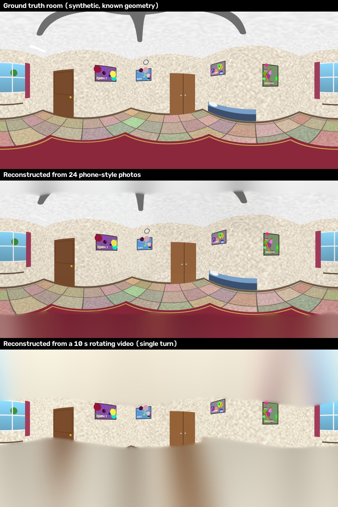
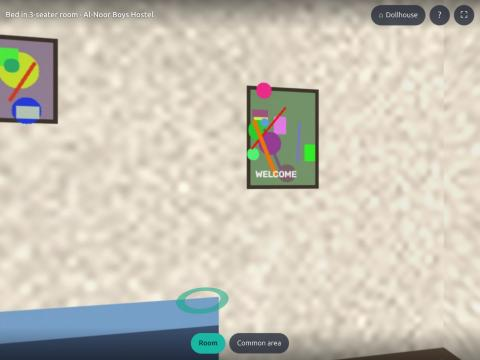
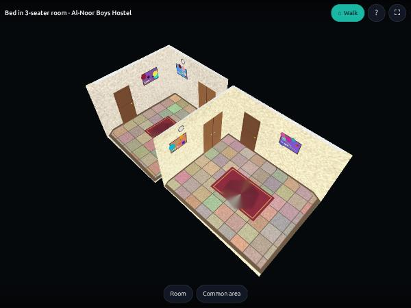

# Kamra — Testing & Results (2026-10-08)

## 1. Summary

| Area | How it was tested | Result |
|---|---|---|
| Backend API + security | `pytest` (31 tests): auth, sessions, OTP, rate limits, headers, IDOR, uploads, privacy rules, moderation, chat, visits, reviews, reports, suspension, account deletion | **31 / 31 passed** (~4 min, incl. real 3D processing) |
| Photos → 3D | Synthetic rooms with known geometry → 24 "phone photos" (65° FOV, exposure jitter, noise, hand jitter) uploaded through the API → worker → manifest → panorama compared with ground truth | All 24 photos registered; full 360° coverage; normalised cross-correlation with ground truth **0.93–0.96** on 3 different rooms |
| Video → 3D | Synthetic 10 s rotating MP4 (hand wobble) uploaded through the API | Keyframes auto-selected (~20), full 360° coverage, NCC **≥ 0.75** (test threshold; 0.86 measured standalone) |
| Hand-held parallax | Person turns their body with the phone 30 cm in front (camera centre moves on a circle — what real users do) | 23–24 photos registered, full 360°, NCC **0.76** (vs 0.955 ideal); mild softness, no failures. Regression-tested in `tests/test_recon.py` |
| Bad capture | 5 dark, featureless, unrelated frames | Tour marked *failed* with human message + actionable hints; API/worker stay healthy |
| Robustness | Rooms with repeated objects (identical posters/doors/tiles) | Before view-graph verification: ghosting (NCC 0.36). After loop-consistency + residual checks: NCC 0.93 |
| 3D viewer | Browser automation on `/viewer/`: look (drag), tap-to-walk, door hotspots, room bar, dollhouse, help dialog, CSP enforced | Works; screenshots in `docs/images/` |
| Mobile app | TypeScript strict typecheck, `expo-doctor` (21 checks), static web export, browser automation at 375×812 (mobile emulation, dark theme) | tsc clean · 21/21 doctor checks · flows verified: explore + filters, listing detail, 3D tour in-app, login, message owner → chat, owner "My listings", manage listing, tour builder |
| Demo data | `seed.py --reset` reconstructs 3 rooms (2 from photos, 1 from video) | All rooms ready |



| Walk mode | Dollhouse |
|---|---|
|  |  |

## 2. How to run

```bash
cd backend && .venv/bin/python -m pytest -v            # all tests
cd backend && .venv/bin/python -m pytest -v tests/test_tours_e2e.py   # just photos/video → 3D
cd mobile  && npx tsc --noEmit && npx expo-doctor
```

## 3. Issues found & fixed during testing

1. **False matches from repeated objects** caused ghosted panoramas → added rotation loop-consistency filtering and post-solve per-pair residual checks (`recon/stitch.py`).
2. **OpenCV zeroes confidence for near-duplicate pairs** (`conf > 3`), breaking the chain for clean captures/video → confidences restored from inlier counts.
3. **Low-texture walls** produced too few features → SIFT contrast threshold lowered, more features per image.
4. **Intermittent native segfault** in the CV stack → reconstruction moved to an isolated child process per room with retry + timeout.
5. **Capture order lost** on upload → inputs now carry a sequence number; the first photo defines the initial view.
6. Video upload temp-file descriptor leak; duplicate-registration race returning 500; unbounded chunked uploads; missing `expo-font` native peer dependency (would crash release builds) — all fixed.

## 4. What was NOT tested here (needs a device / services)

| Item | Why | How to test |
|---|---|---|
| Native Android/iOS builds | No Android SDK / Xcode on this machine | `npx expo run:android` or `eas build --profile preview` |
| Camera capture on device | Needs a phone | Dev build on a phone; capture a real room following the in-app guide |
| Real-world photos | No camera available overnight; synthetic rooms used (exact ray-cast geometry incl. simulated hand-held parallax; real photos additionally add lens distortion, motion blur, moving people and auto-exposure swings) | Capture 3–5 real rooms; check the quality report and hints |
| SMS OTP delivery | Provider not chosen | Plug provider into `routers/auth._send_otp` |
| Load testing | Out of scope for MVP | k6/Locust against staging |
| GPU Gaussian-splat engine | No GPU | Deploy worker on a GPU host (doc 03 §5) |
